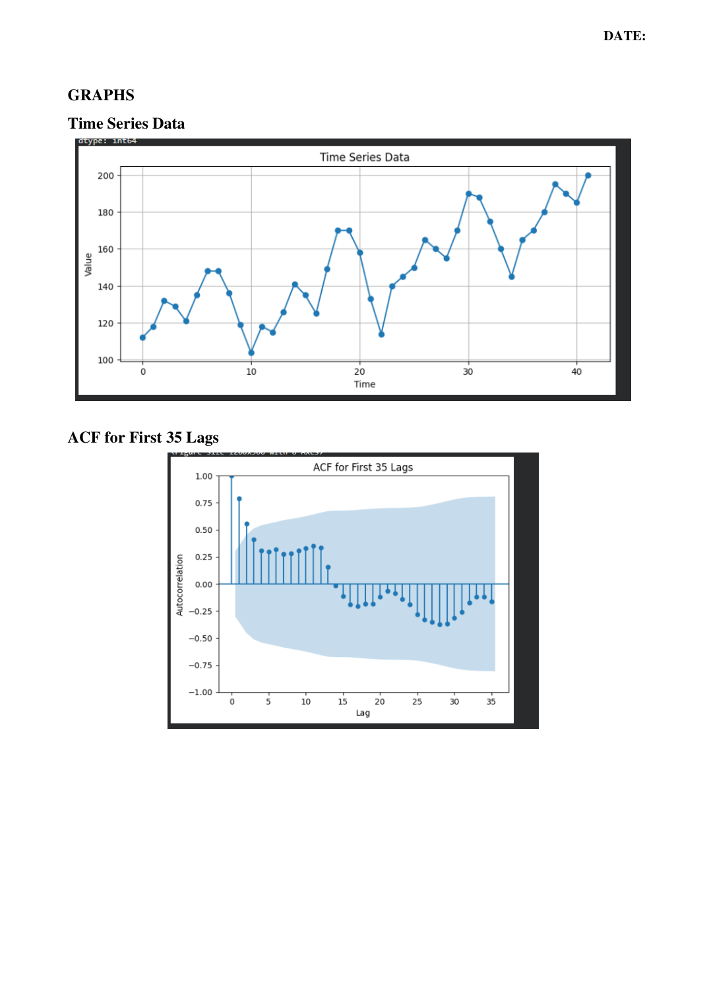

# Experiment 04 – Compute ACF for the First 35 Lags

## Student Details

- **Name:** HANIEL REENA D R
- **Register No:** 2305001008

## Aim
To compute and plot the AutoCorrelation Function (ACF) of a time-series dataset for the first 35
lags and use the ACF pattern to identify a suitable time-series model.

## Algorithm
1. Start the program.
2. Import Pandas, Matplotlib, acf, and plot_acf from statsmodels.
3. Create the given time-series data and convert it into a Pandas Series.
4. Display the time-series values.
5. Plot the original time-series data.
6. Calculate the AutoCorrelation Function for the first 35 lags using nlags = 35.
7. Display the ACF value for each lag from 0 to 35.
8. Plot the ACF graph for the first 35 lags.
9. Observe the ACF pattern to identify whether AR, MA, or ARMA may be suitable.
10. Stop the program.

## Python Program
File: `experiment_04.py`

```python
import pandas as pd
import matplotlib.pyplot as plt
from statsmodels.tsa.stattools import acf
from statsmodels.graphics.tsaplots import plot_acf
data = [
    112, 118, 132, 129, 121, 135,
    148, 148, 136, 119, 104, 118,
    115, 126, 141, 135, 125, 149,
    170, 170, 158, 133, 114, 140,
    145, 150, 165, 160, 155, 170,
    190, 188, 175, 160, 145, 165,
    170, 180, 195, 190, 185, 200
]
series = pd.Series(data)
print("Time Series Data:")
print(series)
plt.figure(figsize=(10, 4))
plt.plot(series, marker='o')
plt.title("Time Series Data")
plt.xlabel("Time")
plt.ylabel("Value")
plt.grid(True)
plt.show()
acf_values = acf(series, nlags=35)
print("\nACF Values:")
for lag, value in enumerate(acf_values):
    print("Lag", lag, ":", round(value, 4))
plt.figure(figsize=(12, 5))
plot_acf(series, lags=35)
plt.title("ACF for First 35 Lags")
plt.xlabel("Lag")
plt.ylabel("Autocorrelation")
plt.show()
```

## Output
### Output Page 3


## Observation
The ACF starts with a high positive value at the first lag and then gradually decreases. At higher
lags, the autocorrelation becomes negative and later moves back toward zero. The pattern tails off
rather than cutting off sharply, so an AR-type or ARMA-type structure may be considered. ACF
alone is not sufficient to determine the exact model order; PACF should also be examined.

## Result
Thus, the ACF of the given time-series data was successfully calculated and plotted for the first 35
lags, and the ACF pattern was examined for possible time-series model identification.

## Installation and Execution
Install the listed libraries:
```bash
pip install -r requirements.txt
```

Run the Python program from this folder:
```bash
python experiment_04.py
```

_Program and output images are transcribed/rendered from the supplied lab PDF._